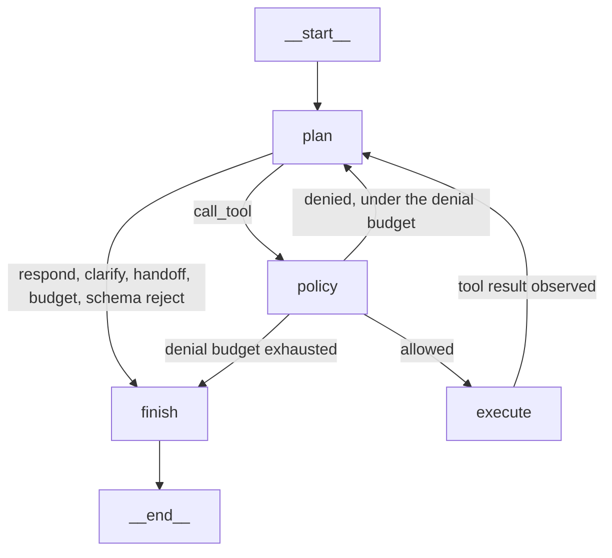

# Phase 2 architecture

Phase 2 keeps the Phase 1 FastAPI, Next.js, and Docker Compose process. `WORKFLOW_PATH` selects the YAML file. Unset, or set to `config/workflows/billing_v1.yaml`, the process is the Phase 1 billing graph. `config/workflows/support_agent_v2.yaml` builds a second LangGraph controller.

## Controller

The parent graph is compiled by `app/workflow/compiler_v2.py`. YAML `transitions` choose the next node. Identity collection and PIN verification reuse the Phase 1 node functions, so PIN is still accepted only by `POST /verify`.

`draw_mermaid()` on that parent lists every conditional target LangGraph registers, including branches a given outcome never takes. The nodes that actually exist are:

`preempt → classify → (clarify | collect_customer_id | support_agent_public | support_agent_protected | human_handoff)`

Verification continues `collect_customer_id → collect_pin → verify_identity → support_agent_protected`. Both agent states go to `validate_response → respond`, or to `human_handoff` on failure. `respond` ends the turn and leaves the conversation open. The next message starts at `classify` again. A verified binding is kept. An operator phrase preempts to `human_handoff` from any non-terminal state.

## Support agent subgraph

`app/workflow/agent_graph.py` compiles a real `StateGraph`. This is the Mermaid render from `get_graph().draw_mermaid()`:

`plan` calls `model.plan()`. Offline, that is `FakeModel` / `ScriptedPlanner`. Live, it is `OpenAIModel` structured JSON validated as `PlannerDecision`. Neither path executes a tool. `policy` is `PolicyGateway.authorize`. `execute` runs only after an allow decision. Protected tools receive the customer id from `TrustedBindings`, not from model arguments.

## Security boundaries

| Boundary | Enforcement |
|---|---|
| Workflow version | `schema_version` 1 or 2. Unknown versions fail at load. |
| Public policy | Loader rejects `get_billing_info` and `get_current_plan` on a policy with `requires_verified_customer: false`. |
| Protected path | A protected agent state is reachable only from `verify_identity` (`verified`) or from `protected_verified` / `mixed_verified` after a server binding exists. |
| Tool arguments | Pydantic schemas. `customer_id`, `verified`, and `role` are removed before validation. |
| Billing read | `BillingService.get_billing(conversation_id)` checks the binding again. |
| PIN | Dedicated `/verify` body. A 4-digit chat message is dropped before graph input on workflow version 2. |
| Answer amounts | Every `円` amount must appear in successful tool `yen_amounts`. One regenerate, then a deterministic fallback, then handoff. |
| Trace | Six fields only, token required, `ENABLE_DEV_TRACE` default false. |
| Writes | No plan-change, payment, refund, or cancel tool exists. |

Prompt files are hashed at load (`prompt_hashes`) and are not returned by the chat API. FAQ text containing instruction markers is withheld by the FAQ tool instead of being copied into the answer.

## Budgets

From `support_agent_v2.yaml`, per turn: 5 tool calls, 6 planner iterations, 1 retry on timeout, 2 consecutive policy denials, 5 second tool timeout setting. The answer composer may run twice when grounding fails. The parent invoke uses recursion limit 25; the subgraph uses 50.
